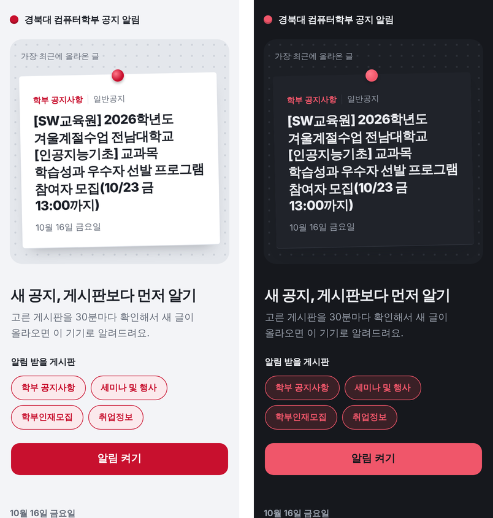
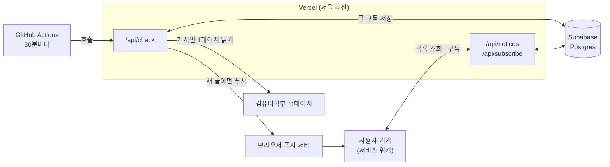

# 컴학 공지 알림

경북대학교 컴퓨터학부 게시판에 새 글이 올라오면 **웹 푸시로 바로 알려주는 PWA**예요.
게시판을 매번 들어가 확인하지 않아도, 고른 게시판의 새 글을 폰과 PC 알림으로 받을 수 있어요.

**🔗 https://knu-cse-notice.vercel.app**

<p align="center">
  
</p>

## 주요 기능

- **게시판별 알림 선택**: 받고 싶은 게시판만 골라서 구독할 수 있어요.
  | 게시판 | 원문 |
  | --- | --- |
  | 학부 공지사항 | [sub6_1_a](https://cse.knu.ac.kr/bbs/board.php?bo_table=sub6_1_a&lang=kor) |
  | 세미나 및 행사 | [sub6_4](https://cse.knu.ac.kr/bbs/board.php?bo_table=sub6_4&lang=kor) |
  | 학부인재모집 | [sub6_3_a](https://cse.knu.ac.kr/bbs/board.php?bo_table=sub6_3_a&lang=kor) |
  | 취업정보 | [sub6_3_b](https://cse.knu.ac.kr/bbs/board.php?bo_table=sub6_3_b&lang=kor) |
- **30분마다 자동 확인**: 새 글이 생기면 `[게시판] 새 글`과 제목이 담긴 알림을 보내고, 누르면 원문으로 이동해요.
- **최근 글 모아보기**: 4개 게시판의 최근 글을 날짜별로 한 화면에서 볼 수 있어요.
- **설치형 웹앱(PWA)**: 홈 화면에 추가해 앱처럼 쓸 수 있고, 다크 모드를 지원해요.
- **로그인 없음**: 계정이나 개인정보 없이 브라우저 알림 권한만으로 동작해요.

## 동작 방식



1. GitHub Actions가 30분마다 `/api/check`를 호출해요. `CRON_SECRET`으로 보호돼 있어요.
2. 서버가 4개 게시판 1페이지를 읽고, 게시판별로 **DB에 저장된 가장 큰 글 번호(`wr_id`)보다 큰 글**을 새 글로 판단해요.
3. 새 글이 있으면 그 게시판을 구독한 기기에만 [Web Push](https://developer.mozilla.org/docs/Web/API/Push_API)로 알림을 보내요.

## 기술 스택

| 영역 | 사용 기술 |
| --- | --- |
| 프론트엔드 | React 19, TypeScript, Vite, Service Worker, Web App Manifest |
| 서버 | Vercel Functions (Node.js), `cheerio`, `web-push` |
| DB | Supabase (PostgreSQL, RLS) |
| 스케줄러 | GitHub Actions (`schedule` cron) |

## 만들면서 고민한 점

- **스크래핑 서버 위치**: 학교 사이트가 해외 IP를 막을 가능성이 있어서, 게시판 요청은 해외에 있는 GitHub Actions가 아니라 **서울 리전(icn1) Vercel 함수**에서 보내요. Actions는 그 함수를 깨우는 역할만 해요.
- **새 글 판별**: 그누보드의 `wr_id`는 게시판마다 계속 커지는 번호라서 "마지막으로 본 번호보다 큰 글"만 새 글로 봐요. 첫 실행은 기준점만 저장해서 기존 글 알림이 한꺼번에 쏟아지지 않게 했어요.
- **장애 격리**: 게시판 하나가 응답하지 않아도 `Promise.allSettled`로 나머지 게시판은 계속 확인해요.
- **구독 정리**: 브라우저에서 만료된 구독(404/410 응답)은 보낼 때 자동으로 DB에서 지워요.
- **키 관리**: DB 서비스 키와 VAPID 비밀키는 서버 환경변수에만 두고, 테이블은 RLS로 잠가서 브라우저에서 직접 접근할 수 없게 했어요.
- **날짜 파싱 버그**: 세미나 게시판은 행사일 칸이 작성일보다 앞에 있어서 날짜가 잘못 읽혔어요. 행의 **마지막 날짜**를 작성일로 쓰도록 고쳤어요.
- **iOS 대응**: 아이폰은 홈 화면에 추가한 웹앱에서만 푸시를 받을 수 있어서(iOS 16.4+), 그 경우 버튼 대신 설치 방법을 안내해요.

## 프로젝트 구조

```
├── api/
│   ├── check.ts          # 게시판 확인 + 새 글 푸시 (cron이 호출)
│   ├── notices.ts        # 최근 글 목록
│   ├── subscribe.ts      # 구독 저장·게시판 선택 변경
│   ├── unsubscribe.ts    # 구독 해제
│   └── _lib/             # 스크래퍼, DB 클라이언트, 푸시 전송
├── src/                  # React 화면, 구독 로직
├── public/               # 서비스 워커(sw.js), manifest, 아이콘
├── supabase/schema.sql   # 테이블 생성 SQL
└── .github/workflows/check.yml   # 30분 주기 실행
```

## 직접 배포하기

<details>
<summary>펼쳐 보기 (약 20분)</summary>

### 1. Supabase
1. 새 프로젝트를 만들어요. 지역은 Seoul을 추천해요.
2. SQL Editor에서 `supabase/schema.sql`을 실행해요.
3. Project Settings → API Keys에서 Project URL과 secret(service_role) 키를 확인해요.

### 2. VAPID 키 만들기
```bash
npx web-push generate-vapid-keys
```

### 3. Vercel
레포를 Import하고 환경변수를 넣은 뒤 Deploy해요. (`.env.example` 참고)

| 이름 | 값 |
| --- | --- |
| `SUPABASE_URL` | Supabase Project URL |
| `SUPABASE_SERVICE_ROLE_KEY` | Supabase secret 키 |
| `VITE_VAPID_PUBLIC_KEY` | VAPID Public Key |
| `VAPID_PRIVATE_KEY` | VAPID Private Key |
| `VAPID_SUBJECT` | `mailto:이메일` 또는 사이트 주소 |
| `CRON_SECRET` | 긴 랜덤 문자열 |

### 4. GitHub Actions
Settings → Secrets and variables → Actions에 등록해요.
- `SITE_URL`: 배포 주소 (끝에 `/` 없이)
- `CRON_SECRET`: Vercel에 넣은 것과 같은 값

Actions 탭에서 **Check new notices → Run workflow**로 한 번 실행하면 기존 글이 저장돼요. 첫 실행에는 알림이 가지 않아요.

### 5. 알림 켜기
배포 주소에서 게시판을 고르고 **알림 켜기**를 눌러요. "알림이 켜졌어요" 확인 알림이 오면 성공이에요.

**새 글 알림 테스트**: Supabase `notices` 테이블에서 한 게시판의 가장 큰 `id` 행을 지우고 Actions를 다시 실행하면, 그 글로 알림이 와요.

</details>

## 로컬 개발

```bash
npm install
npm run dev     # API 없이 예시 데이터로 화면 확인
vercel dev      # API까지 실행 (Vercel CLI, .env 필요)
```

게시판을 추가하거나 빼려면 `api/_lib/scrape.ts`의 `BOARDS`와 `src/App.tsx`의 `BOARD_NAME`·`BOARD_SHORT`를 함께 고쳐요.

## 참고

- 학생이 만든 **비공식** 서비스예요. 학교 서버 부담을 줄이려고 30분 간격으로 각 게시판 1페이지만 읽어요.
- GitHub Actions 예약 실행은 몇 분 늦어질 수 있어요.
- GitHub은 60일 동안 레포 활동이 없으면 예약 실행을 끄는데, 워크플로가 하루 한 번 스스로 "켜기" 요청을 보내 카운트를 초기화해요. 커밋을 만들지 않아서 기록이 깔끔하게 유지돼요.
- 모든 서비스를 무료 플랜 안에서 운영해요.
